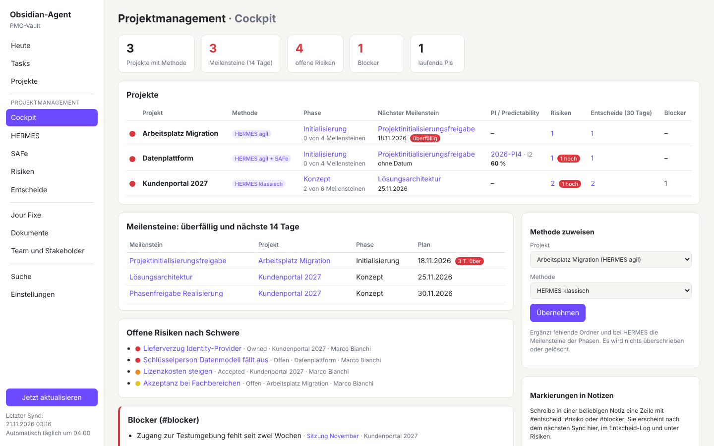
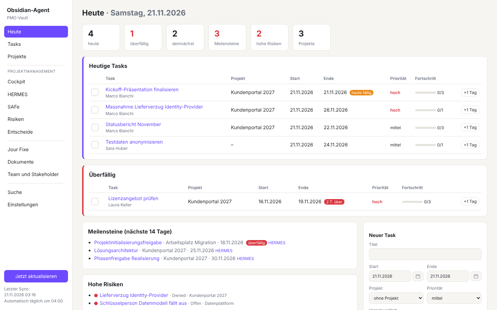
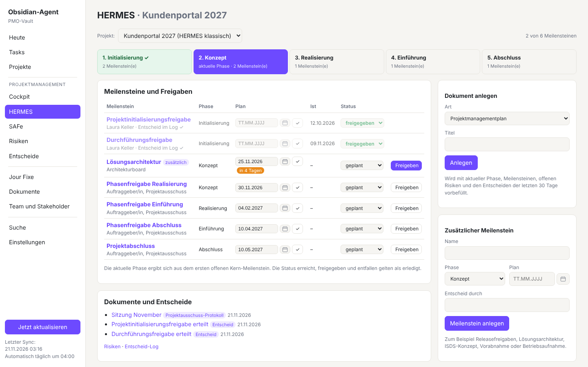
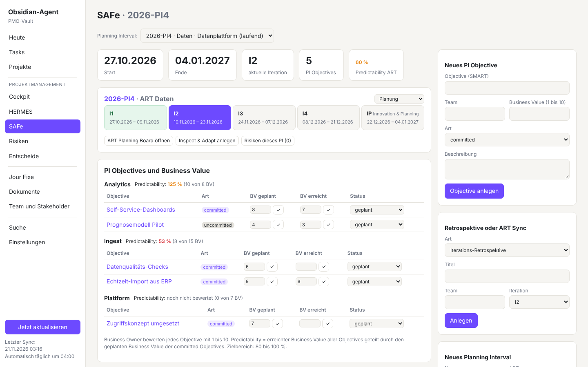
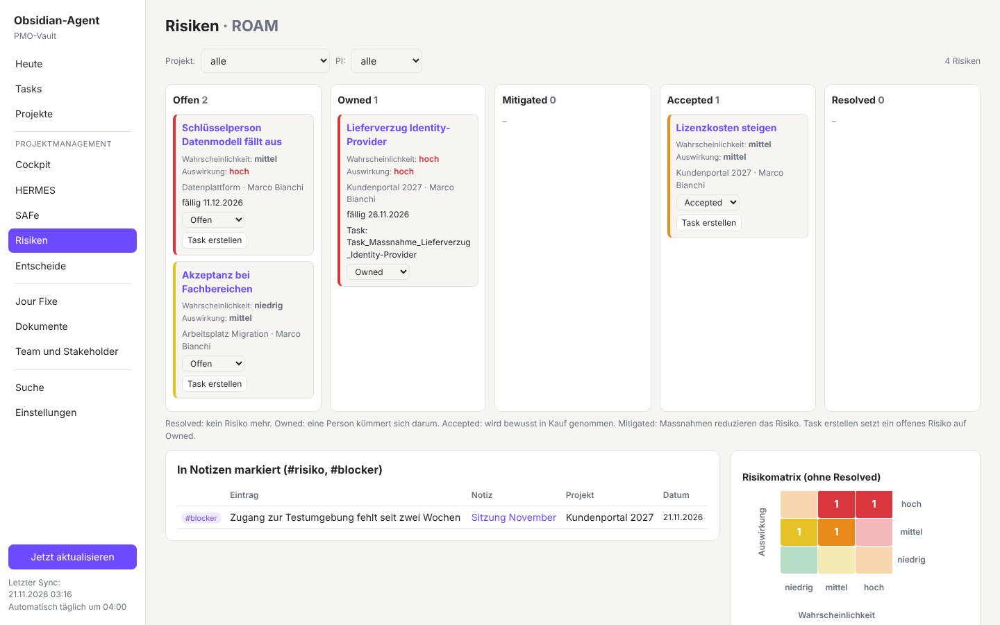
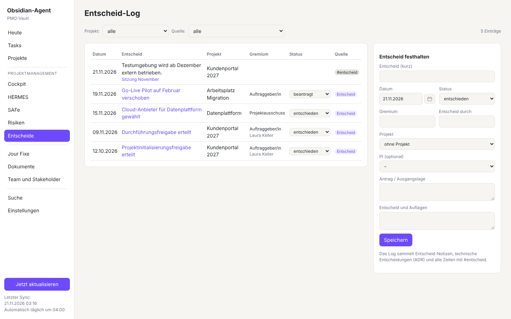
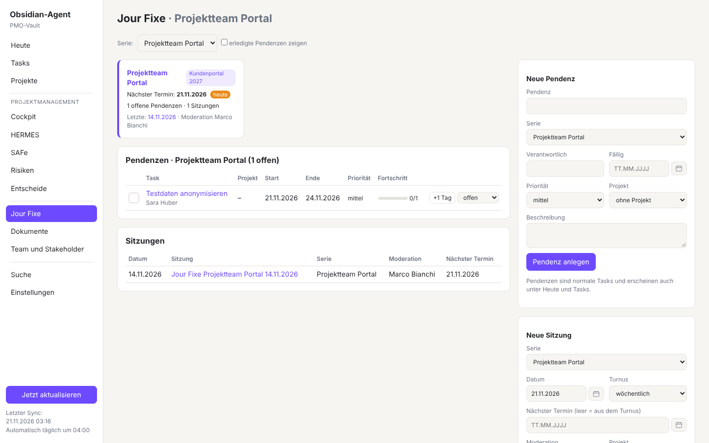
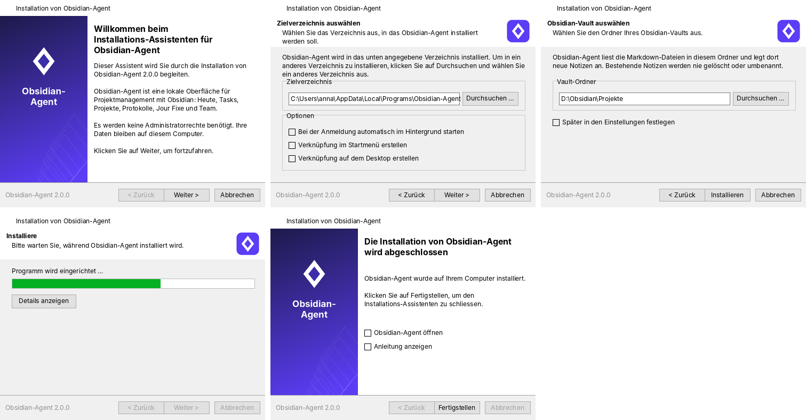

# Obsidian-Agent

**Deutsch** · [English](readme_en.md) · [Español](readme_es.md) · [Dokumentation](obsidian-agent-readme/docs/README.md)

### Dein Obsidian-Vault wird zum Projekt-Cockpit nach HERMES und SAFe.

`Windows` · `macOS` · `Linux` · `Python 3.9+` · `läuft lokal auf 127.0.0.1` · `6 Sprachen`



---

## Das Problem

Du führst Projekte nach HERMES oder SAFe, und deine Notizen liegen in Obsidian. Aber die Steuerung lebt woanders: Meilensteine in einer Excel-Liste, Risiken in einer Präsentation, Entscheide verstreut in Protokollen, PI Objectives auf einem Whiteboard. Vor jedem Projektausschuss suchst du alles zusammen. Und wenn jemand fragt, wer die Durchführungsfreigabe wann erteilt hat, beginnt die Suche von vorn.

## Die Lösung

Obsidian-Agent macht aus deinem Vault ein Projekt-Cockpit. Er legt Projekte mit sauberer Struktur an, führt HERMES-Phasen und Freigaben, plant Planning Intervals, sammelt Risiken und Entscheide und zeigt dir jeden Morgen, was ansteht.

Dabei bleibt alles, wie es ist: **Jede Information ist eine normale Markdown-Datei in deinem Vault.** Du arbeitest weiter in Obsidian, auf dem Laptop oder dem Handy. Der Agent liest beim nächsten Sync alles wieder ein.

| | |
|---|---|
| **Phasen im Griff** | HERMES klassisch oder agil, mit Meilensteinen, Prüfpunkten und Freigaben |
| **Agil skaliert** | SAFe Planning Intervals, PI Objectives, Business Value und Predictability |
| **Nichts geht verloren** | Risiken nach ROAM, ein lückenloses Entscheid-Log, Pendenzen aus jedem Jour Fixe |
| **Keine Doppelerfassung** | Ein `#entscheid` im Protokoll genügt, und der Entscheid steht im Log |
| **Deine Daten bleiben bei dir** | Lokal, ohne Cloud, ohne Konto, ohne Abo |

---

## Funktionen

### Heute: der Morgen beginnt mit Klarheit

Heutige und überfällige Tasks, Meilensteine der nächsten Tage und hohe Risiken auf einen Blick. Abhaken mit einem Klick, verschieben mit „+1 Tag“. Die gleiche Übersicht schreibt der Agent jeden Morgen um 04:00 als Notiz in deinen Vault, damit du sie auch unterwegs auf dem Handy siehst.



### Cockpit: alle Projekte, eine Seite

Für jedes Projekt die aktuelle Phase, der nächste Meilenstein, das laufende PI mit Predictability, offene Risiken, Entscheide der letzten 30 Tage und Blocker. Eine Ampel zeigt dir sofort, wo du hinschauen musst.

### HERMES: Phasen und Freigaben ohne Excel

Beim Anlegen wählst du die Methode, und der Agent legt die Meilensteine nach HERMES 2022 an. Jeder Meilenstein ist eine Notiz mit Prüfpunkten zum Abhaken, von der Studie über das ISDS-Konzept bis zur Projektschlussbeurteilung. Ein Klick auf **Freigeben** setzt Status und Datum und hält den Entscheid gleich im Entscheid-Log fest.

Statusbericht, Projektausschuss-Protokoll und Projektmanagementplan? Kommen vorbefüllt mit Phase, Meilensteinen, offenen Risiken und den Entscheiden der letzten 30 Tage.



### SAFe: das PI auf einen Blick

Planning Interval anlegen, und der Agent rechnet die Iterationen samt IP-Iteration aus. Er legt ein **ART Planning Board als Obsidian-Canvas** an, mit Spalten für Iterationen und Zeilen für Teams. PI Objectives erfasst du je Team mit geplantem und erreichtem Business Value. Die Predictability je Team und für den ganzen ART rechnet der Agent mit. Am Ende des PI erstellt ein Klick die Inspect-&-Adapt-Notiz mit der aktuellen Auswertung.



### Risiken: ROAM statt Bauchgefühl

Ein Board mit den Spalten Offen, Owned, Mitigated, Accepted und Resolved, dazu die Risikomatrix aus Wahrscheinlichkeit und Auswirkung. Aus jeder Massnahme wird mit einem Klick ein Task mit Verantwortung und Termin.



### Entscheide: wer hat was wann beschlossen?

Das Entscheid-Log sammelt automatisch aus drei Quellen: Entscheid-Notizen, technische Entscheidungen (ADR) und jede Zeile mit `#entscheid` in deinen Protokollen. Du schreibst wie gewohnt mit, der Agent sorgt für die Übersicht.

```markdown
## Entscheide
- #entscheid Testumgebung wird ab Dezember extern betrieben.
- #blocker Zugang zur Testumgebung fehlt seit zwei Wochen.
```



### Jour Fixe: keine Pendenz geht mehr verloren

Sitzungsserien mit Turnus und nächstem Termin. Jede neue Sitzungsnotiz enthält automatisch alle offenen Pendenzen der Serie. Pendenzen sind normale Tasks und erscheinen auch unter Heute und bei der verantwortlichen Person.



### Und ausserdem

- **Team und Stakeholder:** Personen mit Rolle, Einfluss und Interesse sowie ihren offenen Tasks
- **Dokumente aus Vorlagen:** 17 Vorlagen für Projektmanagement, alle in Obsidian anpassbar, eigene Vorlagen inklusive
- **Klare Projektstruktur:** von `01_Projektauftrag` bis `99_Archiv`, mit Übersichtsnotiz und Dataview-Tabellen
- **Volltextsuche** über den ganzen Vault
- **Sechs Sprachen:** Deutsch, Englisch, Französisch, Italienisch, Spanisch und Rumänisch. Oberfläche, Ordner und Vorlagen folgen der gewählten Sprache. Für Französisch und Italienisch nutzt der Agent die HERMES-Begriffe der Bundesverwaltung.

---

## Warum nicht einfach ein Plugin?

Dataview und Co. sind grossartig, und der Agent nutzt sie mit. Aber manches können sie nicht:

| | Obsidian-Plugins | Obsidian-Agent |
|---|:---:|:---:|
| Tabellen und Listen in Notizen | ✓ | ✓ |
| Tagesübersicht, auch wenn Obsidian geschlossen ist | – | ✓ |
| HERMES-Meilensteine mit Freigabe und Entscheid-Log | – | ✓ |
| PI-Auswertung mit Predictability | – | ✓ |
| Dokumente vorbefüllt mit Projektdaten | – | ✓ |
| Tageshistorie: wer hat wann was erledigt | – | ✓ |
| Oberfläche ausserhalb von Obsidian, z.B. am Projektausschuss | – | ✓ |

---

## In 5 Minuten startklar



### Windows

1. `Obsidian-Agent-Setup-2.0.0.exe` starten und die Sprache wählen
2. Fehlt Python, installiert der Installer es selbst
3. Ordner deines Obsidian-Vaults wählen, fertig

### macOS

1. `Obsidian-Agent-2.0.0.pkg` öffnen (Rechtsklick > Öffnen)
2. Den Schritten folgen und den Vault wählen
3. Die App **Obsidian-Agent** liegt unter Programme

Die Oberfläche läuft unter `http://127.0.0.1:5055` und startet nach jedem Neustart automatisch im Hintergrund.

Ausführliche Anleitungen und Kurzanleitung mit Bildern: [Dokumentation](obsidian-agent-readme/docs/README.md) · [Deutsch](obsidian-agent-readme/docs/Anleitung_de.md) · [English](obsidian-agent-readme/docs/Guide_en.md) · [Français](obsidian-agent-readme/docs/Guide_fr.md) · [Italiano](obsidian-agent-readme/docs/Guida_it.md) · [Español](obsidian-agent-readme/docs/Guia_es.md) · [Română](obsidian-agent-readme/docs/Ghid_ro.md)

---

## Sicher und ohne Risiko

- **Dein Vault gehört dir.** Alles sind normale Markdown-Dateien. Ohne den Agent funktioniert dein Vault genau wie vorher.
- **Lokal statt Cloud.** Die Oberfläche ist nur auf deinem eigenen Rechner erreichbar. Es gibt kein Konto und kein Abo, und es werden keine Daten an Dritte übertragen.
- **Nichts wird überschrieben.** Beim Ergänzen von Ordnern und beim Wechsel der Methode bleiben bestehende Dateien unverändert.
- **Keine Administratorrechte nötig.**
- **Sauber deinstallierbar.** Einstellungen und Datenbank werden auf dem Desktop gesichert, der Vault bleibt unberührt.

> Die Screenshots zeigen erfundene Beispieldaten.

---

**Weniger suchen. Besser steuern.**

*Obsidian-Agent: das Projekt-Cockpit für deinen Vault.*
