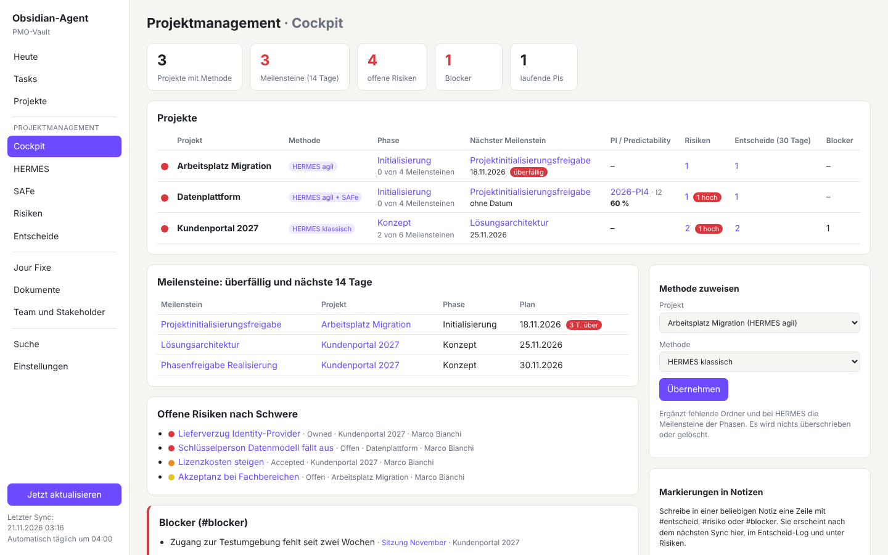
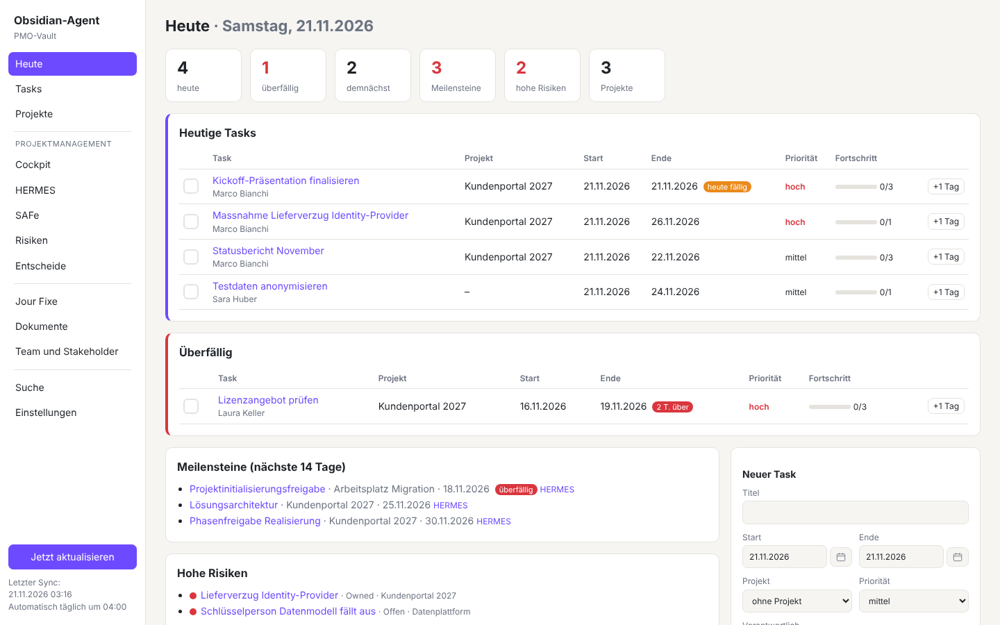
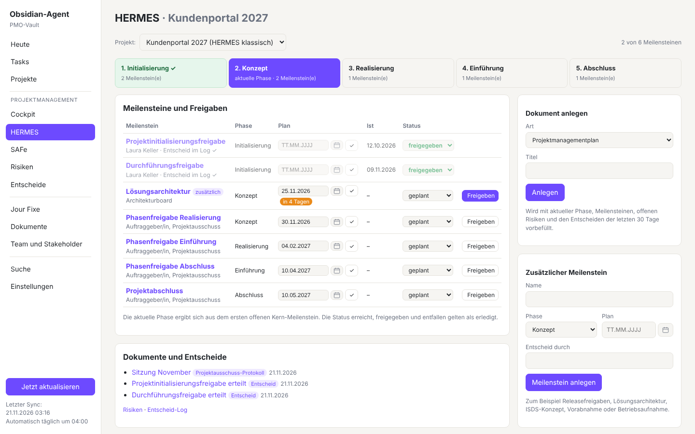
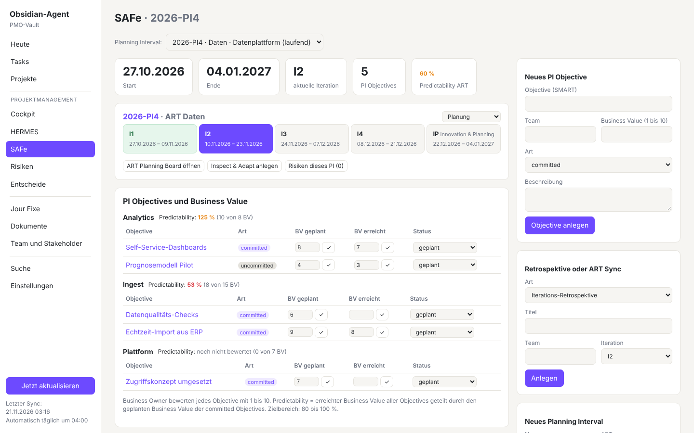
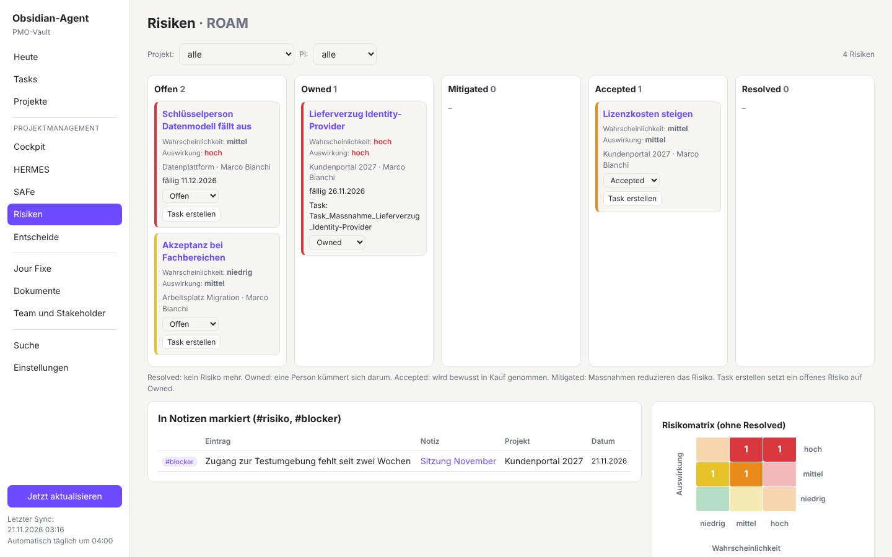
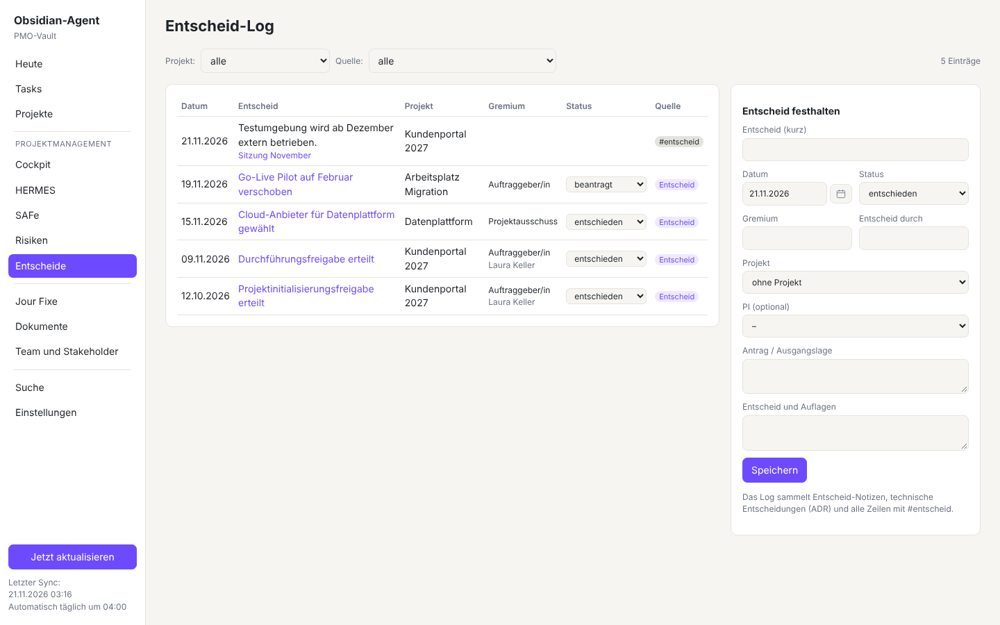
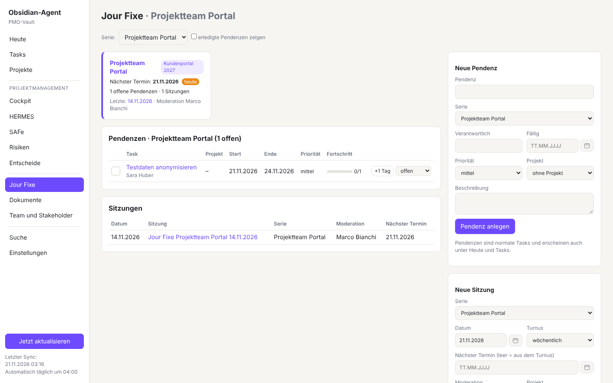

# Obsidian-Agent

[Deutsch](README.md) · **English** · [Español](readme_es.md) · [Documentation](obsidian-agent-readme/docs/README.md)

### Turn your Obsidian vault into a project cockpit for HERMES and SAFe.

`Windows` · `macOS` · `Linux` · `Python 3.9+` · `runs locally on 127.0.0.1` · `6 languages`



---

## The problem

You run projects with HERMES or SAFe, and your notes live in Obsidian. But the actual steering happens elsewhere: milestones in a spreadsheet, risks in a slide deck, decisions scattered across meeting minutes, PI objectives on a whiteboard. Before every steering committee you gather everything by hand. And when someone asks who granted the execution release and when, the search starts all over again.

## The solution

Obsidian-Agent turns your vault into a project cockpit. It creates projects with a clean structure, tracks HERMES phases and approvals, plans planning intervals, collects risks and decisions, and shows you every morning what is due.

And nothing changes about how you work: **every piece of information is a plain Markdown file in your vault.** Keep working in Obsidian, on your laptop or your phone. The agent reads everything back in at the next sync.

| | |
|---|---|
| **Phases under control** | HERMES classic or agile, with milestones, checkpoints and approvals |
| **Agile at scale** | SAFe planning intervals, PI objectives, business value and predictability |
| **Nothing gets lost** | Risks by ROAM, a complete decision log, action items from every recurring meeting |
| **No double entry** | One `#entscheid` in your minutes, and the decision is in the log |
| **Your data stays with you** | Local, no cloud, no account, no subscription |

---

## Features

### Today: start the morning with clarity

Today's and overdue tasks, milestones of the coming days and high risks at a glance. Tick off with one click, postpone with "+1 day". Every morning at 04:00 the agent also writes the same overview as a note into your vault, so you can check it on your phone on the go.



### Cockpit: all projects, one page

For every project: the current phase, the next milestone, the running PI with predictability, open risks, decisions of the last 30 days and blockers. A traffic light shows you right away where to look.

### HERMES: phases and approvals without spreadsheets

Choose the method when creating a project, and the agent creates the milestones according to HERMES 2022. Every milestone is a note with checkpoints to tick off, from the study and the ISDS concept to the project closure assessment. One click on **Approve** sets status and date and records the decision in the decision log right away.

Status report, steering committee minutes and project management plan? They come prefilled with phase, milestones, open risks and the decisions of the last 30 days.



### SAFe: the PI at a glance

Create a planning interval and the agent calculates the iterations including the IP iteration. It creates an **ART Planning Board as an Obsidian canvas**, with columns for iterations and rows for teams. Record PI objectives per team with planned and achieved business value; the agent calculates predictability per team and for the whole ART. At the end of the PI, one click creates the Inspect & Adapt note with the current results.



### Risks: ROAM instead of gut feeling

A board with the columns Open, Owned, Mitigated, Accepted and Resolved, plus a risk matrix of probability and impact. Every measure becomes a task with an owner and a due date in one click.



### Decisions: who decided what, and when?

The decision log collects automatically from three sources: decision notes, technical decisions (ADR) and every line tagged `#entscheid` in your minutes. You take notes as usual; the agent keeps the overview.

```markdown
## Decisions
- #entscheid The test environment will be operated externally from December.
- #blocker Access to the test environment has been missing for two weeks.
```



### Recurring meetings: no action item gets lost

Meeting series with interval and next date. Every new meeting note automatically contains all open action items of the series. Action items are regular tasks and also show up under Today and with the responsible person.



### And also

- **Team and stakeholders:** people with role, influence and interest, plus their open tasks
- **Documents from templates:** 17 project management templates, all editable in Obsidian, your own templates included
- **Clear project structure:** from `01_Project_Mandate` to `99_Archive`, with an overview note and Dataview tables
- **Full-text search** across the whole vault
- **Six languages:** German, English, French, Italian, Spanish and Romanian. Interface, folders and templates follow the chosen language. For French and Italian the agent uses the HERMES terms of the Swiss Federal Administration.

---

## Why not just a plugin?

Dataview and friends are great, and the agent uses them too. But some things they cannot do:

| | Obsidian plugins | Obsidian-Agent |
|---|:---:|:---:|
| Tables and lists in notes | ✓ | ✓ |
| Daily overview, even when Obsidian is closed | – | ✓ |
| HERMES milestones with approval and decision log | – | ✓ |
| PI evaluation with predictability | – | ✓ |
| Documents prefilled with project data | – | ✓ |
| Daily history: who completed what and when | – | ✓ |
| Interface outside Obsidian, e.g. in the steering committee | – | ✓ |

---

## Ready in 5 minutes


### Windows

1. Run `Obsidian-Agent-Setup-2.0.0.exe` and choose the language
2. If Python is missing, the installer installs it for you
3. Choose the folder of your Obsidian vault, done

### macOS

1. Open `Obsidian-Agent-2.0.0.pkg` (right-click > Open)
2. Follow the steps and choose your vault
3. The **Obsidian-Agent** app is in Applications

The interface runs at `http://127.0.0.1:5055` and starts automatically in the background after every restart.

Detailed guides: [Deutsch](obsidian-agent-readme/docs/Anleitung_de.md) · [English](obsidian-agent-readme/docs/Guide_en.md) · [Français](obsidian-agent-readme/docs/Guide_fr.md) · [Italiano](obsidian-agent-readme/docs/Guida_it.md) · [Español](obsidian-agent-readme/docs/Guia_es.md) · [Română](obsidian-agent-readme/docs/Ghid_ro.md)

---

## Safe and risk-free

- **Your vault belongs to you.** Everything is plain Markdown. Without the agent your vault works exactly as before.
- **Local instead of cloud.** The interface is only reachable on your own computer. No account, no subscription, no data sent to third parties.
- **Nothing is overwritten.** When folders are added or the method is changed, existing files remain unchanged.
- **No administrator rights required.**
- **Clean uninstall.** Settings and database are backed up to the desktop; your vault stays untouched.

> The screenshots show fictional sample data in the German interface.

---

**Search less. Steer better.**

*Obsidian-Agent: the project cockpit for your vault.*
