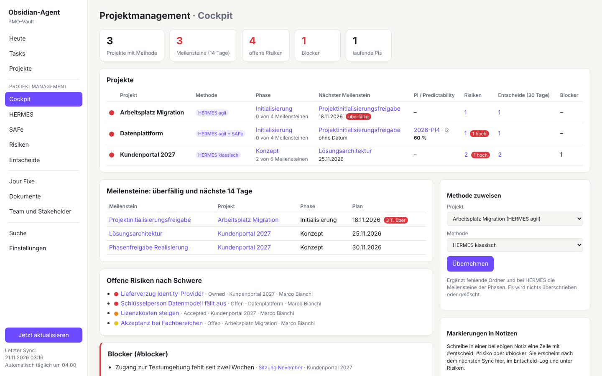
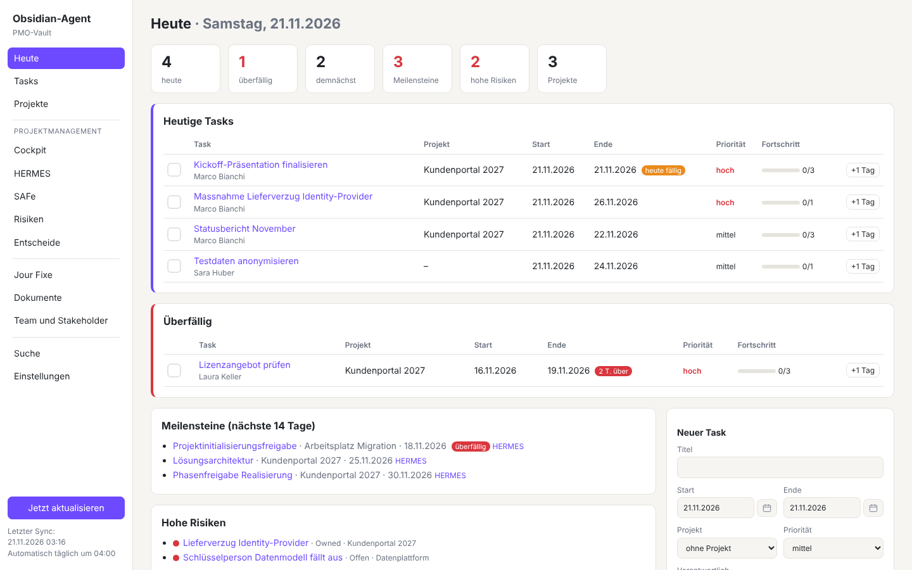
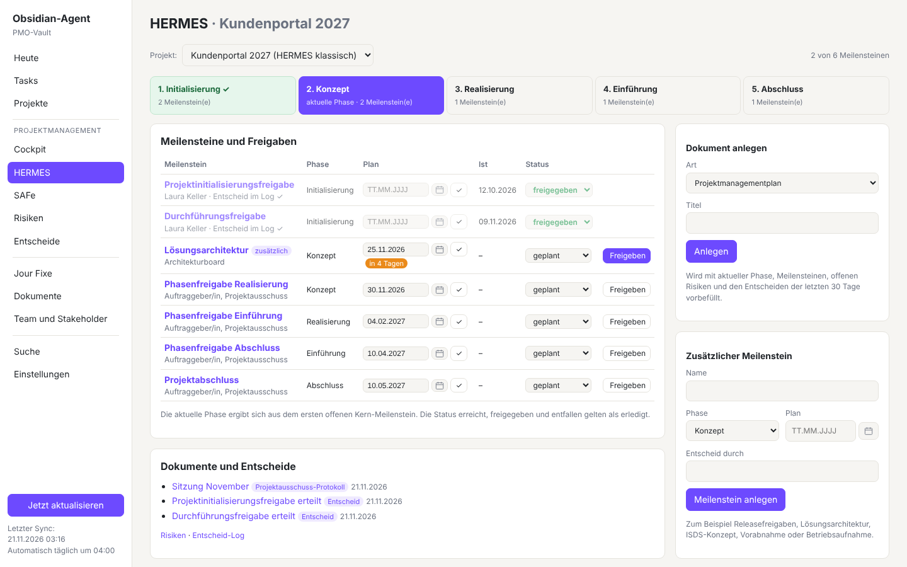
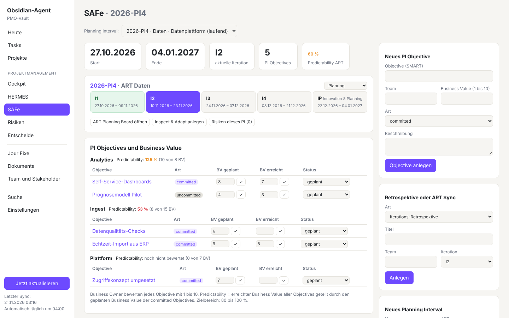
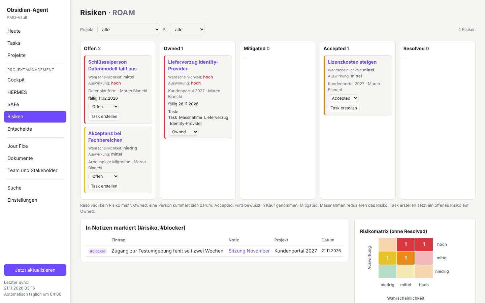
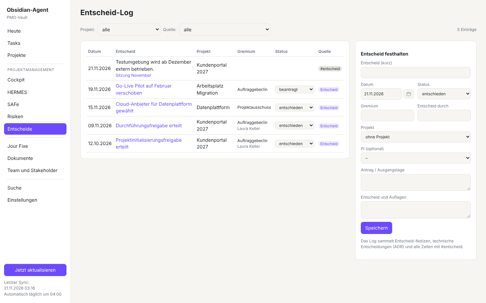
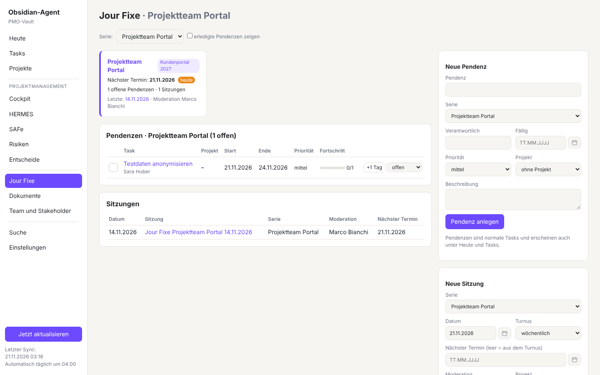

# Obsidian-Agent

[Deutsch](README.md) · [English](readme_en.md) · **Español** · [Documentación](obsidian-agent-readme/docs/README.md)

### Convierte tu bóveda de Obsidian en un cockpit de proyectos para HERMES y SAFe.

`Windows` · `macOS` · `Linux` · `Python 3.9+` · `funciona en local en 127.0.0.1` · `6 idiomas`



---

## El problema

Diriges proyectos con HERMES o SAFe y tus notas están en Obsidian. Pero la dirección del proyecto vive en otra parte: los hitos en una hoja de cálculo, los riesgos en una presentación, las decisiones repartidas entre actas y los objetivos del PI en una pizarra. Antes de cada comité de dirección lo reúnes todo a mano. Y cuando alguien pregunta quién aprobó la ejecución y cuándo, la búsqueda vuelve a empezar.

## La solución

Obsidian-Agent convierte tu bóveda en un cockpit de proyectos. Crea proyectos con una estructura clara, sigue las fases y aprobaciones de HERMES, planifica los Planning Intervals, reúne riesgos y decisiones y cada mañana te muestra lo que toca.

Y tu forma de trabajar no cambia: **cada dato es un archivo Markdown normal en tu bóveda.** Sigue trabajando en Obsidian, en el portátil o en el móvil. En la siguiente sincronización el agente lo vuelve a leer todo.

| | |
|---|---|
| **Fases bajo control** | HERMES clásico o ágil, con hitos, puntos de control y aprobaciones |
| **Ágil a escala** | Planning Intervals de SAFe, objetivos de PI, valor de negocio y previsibilidad |
| **Nada se pierde** | Riesgos según ROAM, un registro de decisiones completo, asuntos pendientes de cada reunión |
| **Sin duplicar datos** | Basta un `#entscheid` en el acta y la decisión queda en el registro |
| **Tus datos se quedan contigo** | En local, sin nube, sin cuenta, sin suscripción |

---

## Funciones

### Hoy: la mañana empieza con claridad

Las tareas de hoy y las atrasadas, los hitos de los próximos días y los riesgos altos de un vistazo. Márcalas con un clic o aplázalas con "+1 día". Cada mañana a las 04:00 el agente escribe además el mismo resumen como nota en tu bóveda, para que lo veas también en el móvil.



### Cockpit: todos los proyectos en una página

Para cada proyecto: la fase actual, el próximo hito, el PI en curso con su previsibilidad, los riesgos abiertos, las decisiones de los últimos 30 días y los bloqueos. Un semáforo te indica al instante dónde mirar.

### HERMES: fases y aprobaciones sin hojas de cálculo

Al crear el proyecto eliges el método y el agente crea los hitos según HERMES 2022. Cada hito es una nota con puntos de control para marcar, desde el estudio y el concepto de seguridad hasta la evaluación final del proyecto. Un clic en **Aprobar** fija el estado y la fecha y registra la decisión directamente en el registro de decisiones.

¿Informe de estado, acta del comité de dirección o plan de gestión del proyecto? Llegan rellenados con la fase, los hitos, los riesgos abiertos y las decisiones de los últimos 30 días.



### SAFe: el PI de un vistazo

Crea un Planning Interval y el agente calcula las iteraciones, incluida la iteración IP. Crea un **ART Planning Board como lienzo de Obsidian**, con columnas para las iteraciones y filas para los equipos. Registras los objetivos de PI por equipo con el valor de negocio planificado y alcanzado; el agente calcula la previsibilidad por equipo y para todo el ART. Al final del PI, un clic crea la nota de Inspect & Adapt con la evaluación actual.



### Riesgos: ROAM en lugar de intuición

Un tablero con las columnas Abierto, Owned, Mitigated, Accepted y Resolved, y una matriz de riesgos de probabilidad e impacto. Cada medida se convierte con un clic en una tarea con responsable y fecha.



### Decisiones: ¿quién decidió qué y cuándo?

El registro de decisiones se alimenta automáticamente de tres fuentes: notas de decisión, decisiones técnicas (ADR) y cada línea marcada con `#entscheid` en tus actas. Tú tomas notas como siempre; el agente se encarga del resumen.

```markdown
## Decisiones
- #entscheid A partir de diciembre el entorno de pruebas se operará externamente.
- #blocker Hace dos semanas que falta el acceso al entorno de pruebas.
```



### Reuniones periódicas: ningún asunto pendiente se pierde

Series de reuniones con frecuencia y próxima fecha. Cada nueva nota de reunión incluye automáticamente todos los asuntos pendientes abiertos de la serie. Los asuntos pendientes son tareas normales y aparecen también en Hoy y en la persona responsable.



### Y además

- **Equipo y partes interesadas:** personas con rol, influencia e interés, y sus tareas abiertas
- **Documentos a partir de plantillas:** 17 plantillas de gestión de proyectos, todas editables en Obsidian, también las tuyas
- **Estructura de proyecto clara:** de `01_Mandato_del_proyecto` a `99_Archivo`, con nota de resumen y tablas Dataview
- **Búsqueda de texto completo** en toda la bóveda
- **Seis idiomas:** alemán, inglés, francés, italiano, español y rumano. La interfaz, las carpetas y las plantillas siguen el idioma elegido.

---

## ¿Por qué no simplemente un plugin?

Dataview y compañía son estupendos, y el agente también los usa. Pero hay cosas que no pueden hacer:

| | Plugins de Obsidian | Obsidian-Agent |
|---|:---:|:---:|
| Tablas y listas en las notas | ✓ | ✓ |
| Resumen diario, incluso con Obsidian cerrado | – | ✓ |
| Hitos HERMES con aprobación y registro de decisiones | – | ✓ |
| Evaluación del PI con previsibilidad | – | ✓ |
| Documentos rellenados con datos del proyecto | – | ✓ |
| Historial diario: quién terminó qué y cuándo | – | ✓ |
| Interfaz fuera de Obsidian, p. ej. en el comité de dirección | – | ✓ |

---

## Listo en 5 minutos


### Windows

1. Ejecuta `Obsidian-Agent-Setup-2.0.0.exe` y elige el idioma
2. Si falta Python, el instalador lo instala por ti
3. Elige la carpeta de tu bóveda de Obsidian y listo

### macOS

1. Abre `Obsidian-Agent-2.0.0.pkg` (clic derecho > Abrir)
2. Sigue los pasos y elige tu bóveda
3. La app **Obsidian-Agent** está en Aplicaciones

La interfaz funciona en `http://127.0.0.1:5055` y se inicia automáticamente en segundo plano tras cada reinicio.

Guías detalladas: [Deutsch](obsidian-agent-readme/docs/Anleitung_de.md) · [English](obsidian-agent-readme/docs/Guide_en.md) · [Français](obsidian-agent-readme/docs/Guide_fr.md) · [Italiano](obsidian-agent-readme/docs/Guida_it.md) · [Español](obsidian-agent-readme/docs/Guia_es.md) · [Română](obsidian-agent-readme/docs/Ghid_ro.md)

---

## Seguro y sin riesgos

- **Tu bóveda es tuya.** Todo es Markdown normal. Sin el agente, tu bóveda funciona exactamente igual que antes.
- **En local, no en la nube.** La interfaz solo es accesible en tu propio ordenador. Sin cuenta, sin suscripción y sin enviar datos a terceros.
- **No se sobrescribe nada.** Al añadir carpetas o cambiar el método, los archivos existentes no cambian.
- **No se necesitan derechos de administrador.**
- **Desinstalación limpia.** Los ajustes y la base de datos se guardan en el escritorio; tu bóveda queda intacta.

> Las capturas muestran datos de ejemplo ficticios en la interfaz en alemán.

---

**Busca menos. Dirige mejor.**

*Obsidian-Agent: el cockpit de proyectos para tu bóveda.*
